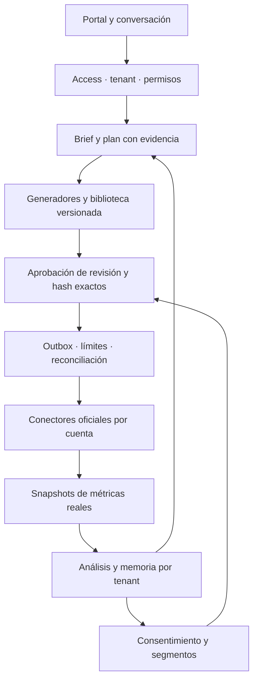

# EMP-003: ciclo operativo completo

Fecha: 28/10/2026. Alcance permanente: PLANIFICAR → CREAR ASSETS → APROBAR → PUBLICAR → MEDIR → OPTIMIZAR → APRENDER → REMARKETING. Una propuesta generada no es una campaña ejecutada. Una respuesta HTTP aceptada no demuestra publicación. Una métrica ausente nunca se sustituye por un resultado simulado.

## Punto de partida y evidencia

- [PR #304](https://github.com/dito2001-art/herreb-employee-core/pull/304), código `0dd809758530f7b634c44062f0699e48b68602ed`, desplegado únicamente en piloto; versión observada `be751f6f-25be-46ab-ab3f-d36a9894f424`.
- [Portal protegido](https://herreb-emp003-staging.herreb-emp003-pilot.workers.dev/). Cuenta `43147827695cce6931d9dc625ec240a7`. Access dedicado; A owner de `herreb-client-0`; B user de `herreb-emp003-test-b`, sin privilegios de HerreB Owner.
- El editor corregido se observó autenticado con todos los campos. Se solicitó generación real; esta ejecución no constituye todavía cierre E2E de #304. El estado exacto debe tomarse del read-back y las pruebas de campaña, no de esta descripción.
- No se habilitan publicación externa ni gasto. La allowlist de investigación actual solo admite `developers.cloudflare.com`; eso limita el piloto y no certifica investigación de cualquier marca.

## Reutilización: implementación no equivale a conector certificado

| Módulo existente | Reutilización | Límite comprobado |
|---|---|---|
| `src/runtime/emp003-browser-*`, `emp003-generate-campaign.ts` | Access JWT, tenant server-side, propuesta real Workers AI, BFF del portal | No publica; generación no persiste por sí misma |
| `src/adapters/emp003-cloudflare-browser.ts`, `emp003-grounded-brief.ts` | Investigación con fuentes permitidas y evidencia | No es un buscador general; máximo dos semillas |
| `src/core/marketing-content-orchestrator.ts`, `marketing-content.ts` | Brand voice, oferta/audiencia/objetivo, claims verificados, generador inyectable | No hay producción de imagen/video certificada |
| `src/core/marketing-blueprint-persistent.ts`, `src/runtime/emp003-campaign-state.ts` | Persistencia, IDs, revisiones, CAS y APPROVED inmutable | Estado editorial separado del operacional |
| `marketing-content-approval.ts`, `emp003-gated-publisher.ts`, `emp003-publish-preflight.ts` | Aprobación y frontera de ejecución condicionada | `ContentPublisher` es una interfaz, no un canal conectado |
| `campaign.ts`, `campaign-execution.ts`, `durable.ts` | Estados de ejecución, acciones, jobs, idempotency keys, interfaz de dispatcher | Requiere implementación durable del outbox/reconciliación por canal |
| `marketing-attribution-persistent.ts`, `marketing-handoff.ts`, `marketing-learning.ts` | Trazabilidad lead/campaña, resultados con evidencia y recomendaciones | No recopilan por sí mismos métricas de Ads ni prueban causalidad/ROAS |
| `runtime/bootstrap.ts`, `core/executor.ts`, `core/adapters.ts` | Registro de capacidades por tenant y controlled writes | No ampliar permisos de una capability por el solo hecho de registrar un adapter |

Se revisaron fuentes del candidato integrado y se buscaron `ContentPublisher`/`marketing` en las ramas por defecto accesibles de runtime/CRM. No aparecieron conectores adicionales en esas búsquedas. Se declaran **NO CERTIFICADOS**, no inexistentes: integraciones ocultas, ramas no examinadas y configuración externa. El transporte Meta WhatsApp no se reutiliza como token de Instagram/Ads ni se modifica EMP-001/002.

## Arquitectura modular

1. **Conversación:** transforma lenguaje natural en un brief validado y preguntas sobre faltantes. Reutiliza el servicio de generación; no abre agents/WebSockets bloqueados ni extrae tenant de un prompt. Una instrucción de publicar nunca sustituye la autorización operativa.
2. **Assets:** generadores separados por texto, imagen, gráfico, video y email; cada resultado conserva proveedor/modelo, prompt versionado, evidencia, canal, MIME, dimensiones/duración y hashes cuando corresponda. Renderizar y validar los bytes reales antes de declarar una pieza disponible. Las versiones adaptadas conservan relación con el asset padre. Nueva biblioteca core conserva bytes/referencias, versiones CAS, operación idempotente y hash; `src/runtime/emp003-asset-storage.ts` adapta transacciones DO y object storage R2 sin crear bindings; no afirma que exista un generador de video ni valida codecs por sí sola.
3. **Persistencia:** metadatos y punteros en almacenamiento transaccional del tenant; binarios en object storage separado por entorno, con claves `tenant/campaign/asset/hash`. Usar recursos del piloto solo tras autorización específica de bindings/recursos. No guardar binarios en KV ni URLs públicas permanentes. Objetos sin metadata por CAS fallido quedan huérfanos recuperables, nunca publicados; GC posterior y conservador.
4. **Estados:** `blueprint.status=DRAFT` no sustituye `reviewState`. El modelo operacional `MarketingCampaign` conserva su lifecycle existente. Mapear ambos mediante campaignId y referencia a revisión, sin interpretar APPROVED editorial como permiso de publicar cualquier contenido. Aprobación de assets debe estar anclada a revisión/hash, actor, canal y cuenta; una versión nueva exige revisión nueva.
5. **Publicación:** reutilizar gated publisher y executor, detrás de outbox transaccional. Comando firmado/autorizado: tenant, cuenta externa, canal, campaignId, assetRevision/hash, ventana y presupuesto. Estados propuestos para el recibo del intento: PENDING, IN_FLIGHT, CONFIRMED, FAILED, UNKNOWN. Timeout después de envío => UNKNOWN, reconciliar por ID del proveedor; nunca reenviar ciegamente. Reserva de presupuesto atómica en unidades menores y moneda explícita; organic exige autorización de publicar aunque su gasto sea cero.
6. **Métricas:** adaptadores de solo lectura, cursor/reintentos acotados, provenance de cuenta/proveedor/campaña/ventana/zona horaria/moneda y payload hash. Raw snapshots inmutables; derivadas reproducibles. CTR/CPC/CPL/ROAS quedan indisponibles si faltan denominadores o evidencia. Ingresos atribuibles requieren vínculo verificable con operaciones comerciales y reglas de atribución acordadas; no inferir causalidad de clics.
7. **Optimización:** recomendaciones primero. Ejecución autónoma solo con política previa, límites de presupuesto y cambios permitidos, ventana, límites de frecuencia y aprobación de nuevas versiones cuando corresponda. Memoria por tenant con evidencia, procedencia y caducidad; evitar aprender conclusiones de métricas simuladas o muestras insuficientes.
8. **Remarketing:** ledger autoritativo de consentimiento, finalidad, vigencia/revocación y eliminación. Segmentos segregados por tenant/cuenta; sincronizar solo con permisos específicos y reglas vigentes del canal. No construir audiencias desde campañas del otro tenant ni desde datos personales sin base autorizada.

## Conectores oficiales y primer canal

No se selecciona ni conecta una cuenta del propietario por inferencia. El primer canal se decide por disponibilidad real de cuenta, producto API y permisos; comenzar con una publicación orgánica autorizada y presupuesto de publicidad cero. No recomendar Ads antes de demostrar una publicación y lectura independiente.

- LinkedIn: [Posts API](https://learn.microsoft.com/en-us/linkedin/marketing/community-management/shares/posts-api?view=li-lms-2026-10), [acceso a productos/permisos](https://learn.microsoft.com/en-us/linkedin/marketing/increasing-access), [Community Management](https://learn.microsoft.com/en-us/linkedin/marketing/community-management/community-management-overview). Candidato sujeto a acceso del producto, rol de cuenta y scopes. POST confirmado requiere ID del proveedor y GET independiente; el permiso de escribir no implica permiso de analytics. No invocar estas APIs hasta seleccionar canal/cuenta y conceder autorización.
- Instagram/Meta: candidato **pendiente de validación oficial** del flujo de login y producto habilitado. La documentación oficial no se pudo recuperar en esta sesión; no se fijan scopes ni versión por recuerdo o guías de terceros. No confundir credenciales de WhatsApp con publicación/Ads.
- [Catálogo oficial Workers AI](https://developers.cloudflare.com/workers-ai/models/): base existente para generación textual; cualquier modelo multimedia, cuota, costo y formato se verifica antes de integrar. No se activan compras, planes o proveedores externos.
- Email: elegir proveedor y dominio autorizados, confirmar entregabilidad/consentimiento y disponer de recibo/lectura de estado. No usar correo personal ni contactos del CRM personal como atajo.

## Plan incremental y aceptación E2E

| Orden | Entrega | Criterio verificable | Dependencia externa |
|---|---|---|---|
| 0 | Cerrar #304 real | A crea/edita/guarda, recarga, GET independiente; dos tabs generan CAS obsoleto rechazado; APPROVED bloquea edición; B no ve campaña A; sin publicación | Sesiones A/B y navegador operativo. B sigue user/read-only; no exigirle crear ni ampliar su rol |
| 1 | Conversación + copy/email + biblioteca | Brief desde instrucción, faltantes explícitos, generación real, edición, registro de bytes/hash/revisión; recarga/read-back; concurrencia e intento cross-tenant rechazados | Deploy específico y almacenamiento/binarios autorizados cuando corresponda |
| 2 | Imagen/gráfico y luego video | Archivo real descargable, preview/render válido, adaptación de formato por canal, lineage y read-back de hash; rechazo de salida inválida/timeout | Proveedor/modelo y costo autorizados; credencial solo si requerida |
| 3 | Un canal orgánico real | Actor aprueba revisión/hash/cuenta; un único post con ID y GET independiente; intento repetido/concurrente no duplica; timeout ambiguo reconcilia; revocación bloquea nuevas escrituras | Canal, cuenta, scopes, ventana y aprobación de contenido exacto; gasto Ads=0 |
| 4 | Medición y dashboard | Snapshot real cotejado con proveedor; cursor repetido no duplica; filtros tenant/cuenta/ventana; no se inventan métricas faltantes | Permiso de analytics separado y acceso al sistema de ingresos si se exige ROAS |
| 5 | Optimización y memoria | Recomendación basada en datos reales, muestra insuficiente explícita, ejecución fuera de límites rechazada; aprendizaje persistido y recuperable solo por tenant | Política de autonomía y presupuesto aprobada antes de ejecutar |
| 6 | Remarketing multicanal | Solo sujetos con consentimiento vigente; revocación/exclusión efectiva; segmento aislado; una sincronización autorizada cotejada con proveedor | Base autorizada, reglas del canal y permisos de audiencia; aprobación específica |

El orden no permite declarar la etapa siguiente certificada porque sus interfaces existan. Cada resultado conserva SHA, versión desplegada, tenant/actor, IDs, timestamps y evidencia independiente. Nuevos módulos permanecen sin rutas, conectores activos, publicación, migraciones ni deploy hasta autorizar su operación.

## Decisiones inevitables, cuando corresponda

1. Completar el ingreso real de B y recuperar control del navegador para cerrar la evidencia #304.
2. Elegir un canal y cuenta empresarial concretos; confirmar acceso API de escritura y lectura, contenido aprobado y ventana. No solicitar todavía credenciales de todos los canales.
3. Autorizar almacenamiento multimedia/proveedor/modelo y límites de costo solo para la entrega que lo necesita.
4. Definir después límites de optimización y política de consentimiento/atribución; no asumirlos de un prompt de generación.
